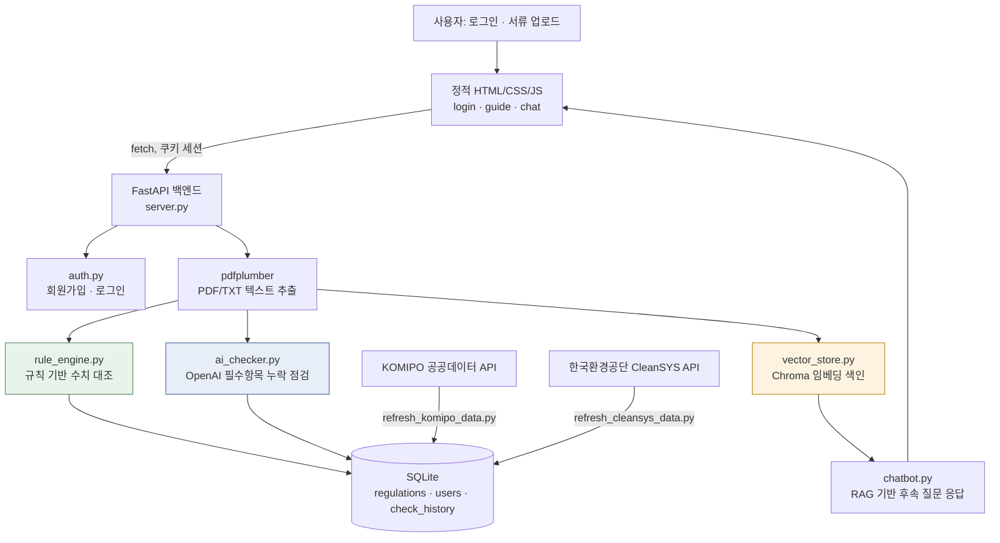

# AI 컴플라이언스 시뮬레이터

발전소 인허가 서류를 업로드하면 법령·실제 허가기준과 AI가 자동으로 대조해, 위반 위험과 누락 항목을 사전에 찾아주는 **하이브리드(규칙엔진 + LLM) 컴플라이언스 챗봇**입니다.

> 2026 KOMIPO 「혁신 50대 과제」 대국민 아이디어 공모 제출용으로 시작한 프로젝트이며, 아이디어를 검증하기 위해 실제 동작하는 프로토타입까지 직접 구현했습니다.

## 목차

- [문제](#문제)
- [데모](#데모)
- [아키텍처](#아키텍처)
- [기술 선택 이유](#기술-선택-이유)
- [실행 가이드](#실행-가이드)
- [트러블슈팅 기록](#트러블슈팅-기록)
- [성과 지표](#성과-지표)

## 문제

발전소가 건설·정비 시 제출하는 인허가서류(환경영향평가서·안전계획서)는 수백 페이지 규모이고, 이를 규율하는 대기환경보전법·물환경보전법·중대재해처벌법 등은 수시로 개정됩니다. 담당자가 이 방대한 서류를 수작업으로 법령·기준치와 대조하는 과정에서 휴먼에러(수치 누락, 오기재)가 발생하기 쉽고, 서류가 반려되면 공사 지연·행정력 낭비·법적 리스크로 직결됩니다.

더 근본적인 문제는, **법령 원문의 "일반 기준"과 발전소별로 실제 적용되는 "허가 기준"이 다르다**는 점입니다. 예를 들어 대기환경보전법 시행규칙 별표8의 액체연료 발전시설 질소산화물 일반기준은 50ppm이지만, 실제 KOMIPO 보령화력의 허가기준은 호기별로 24~40ppm입니다. 설비 설치 시기·연료 종류·용량에 따라 개별 인허가 시 적용 기준이 달라지기 때문입니다. 즉 법령 조문만 대조해서는 부족하고, 발전소별 실제 데이터와 함께 봐야 의미가 있습니다.

## 해결 방식 — 하이브리드 검증 구조

- **규칙 기반 엔진**: 배출허용치처럼 숫자로 딱 떨어지는 정량 기준은 결정론적 규칙으로 정확하게 대조합니다(AI 환각 리스크 배제).
- **LLM 보조**: 중대재해처벌법의 "안전보건관리체계를 갖췄는가"처럼 문맥 판단이 필요한 필수 기재 항목 누락 점검에는 AI를 보조적으로만 사용합니다.
- **역할 분리로 신뢰도 확보**: "법적 기준 대조는 규칙, 문서 완결성 검토는 AI"라는 원칙을 지켜, AI가 최종 법적 판단을 대체하지 않도록 설계했습니다.

## 데모

**Live Demo**: [Live Demo](https://komipo-ai-compliance-production.up.railway.app)
로컬에서 직접 실행해 확인할 수도 있습니다(아래 [실행 가이드](#실행-가이드) 참고). 화면 흐름은 다음과 같습니다.

| 단계 | 화면 | 내용 |
|---|---|---|
| 1 | 로그인 / 회원가입 | 아이디·비밀번호와 함께 **소속 발전소**를 선택해 가입. 로그인하면 그 발전소로 조회 범위가 고정됨 |
| 2 | 서비스 가이드 | 로그인 직후 화면. 상단에 로그인한 발전소명이 표시되고, 서비스 사용법을 간단히 안내 |
| 3 | 챗봇 (문서 업로드) | 인허가 서류(PDF/TXT)를 업로드하면, 규칙 엔진 + AI 체커 결과를 종합해 대화창에 안내 |
| 4 | 챗봇 (검토 결과) | 결과를 **위반 위험 / 기준 이내 / 미기재** 3개의 접힌 토글로 정리해서 보여줌 (심각도 기준으로, 규칙 결과와 AI 결과를 소스가 아니라 상태별로 병합) |
| 5 | 챗봇 (후속 질문) | "왜 위반이야?", "먼지 항목 어떻게 고쳐?" 같은 질문을 하면, 방금 업로드한 문서·관련 법령 조각을 벡터DB에서 검색(RAG)해 근거 기반으로 답변 |

테스트용 샘플 서류(`prototype/sample_document.txt`)는 먼지 9.5mg/Sm3·질소산화물 30ppm·BOD 65mg/L을 담고 있고, 황산화물과 중대재해처벌법 "종사자 의견 청취 절차" 항목은 의도적으로 뺐습니다. 같은 서류라도 로그인한 계정의 발전소에 따라 판정이 달라지는 걸 보여주도록 구성했습니다(발전소별 실제 허가기준이 다르기 때문).

## 아키텍처



프로토타입에서 실제로 구현·검증된 구조입니다. 전사 도입 시의 장기 비전(HWP 파서, 법제처 API 자동 연동, 전자결재 연동 등)은 별도로 `시스템아키텍처_설계.md`·`시스템아키텍처_다이어그램.mermaid`에 정리해뒀습니다.

**핵심 모듈**

| 파일 | 역할 |
|---|---|
| `server.py` | FastAPI 백엔드 — 로그인/회원가입/문서 업로드/채팅 REST API, 쿠키 기반 인메모리 세션 |
| `static/` | 순수 HTML/CSS/JS 프론트엔드 (프레임워크·번들러 없음) |
| `rule_engine.py` | 배출허용치 등 정량 기준 규칙 기반 대조 |
| `ai_checker.py` | 업로드 직후 OpenAI 기반 필수 항목 누락 점검 |
| `chatbot.py` / `vector_store.py` | RAG 기반 후속 질문 응답 (Chroma 임베딩 색인·검색) |
| `komipo_api.py` / `cleansys_api.py` | 발전소별 실제 허가기준·실측값을 제공하는 두 개의 독립된 공공데이터 API 연동 |
| `db.py` | SQLite 연결 어댑터 (스키마 자동 생성) |

## 기술 선택 이유

**Streamlit → FastAPI + 정적 HTML/CSS/JS**: 처음엔 프로토타입 개발 속도를 위해 Streamlit으로 시작했습니다. 하지만 UI 커스터마이징 자유도가 낮아 완성도 있는 화면을 만들기 어려웠고, 실제 서비스에 가까운 형태를 보여주고 싶어서 REST API(FastAPI) + 순수 프론트엔드로 분리했습니다. 비즈니스 로직 모듈(`rule_engine.py`, `ai_checker.py` 등)은 프레임워크에 의존하지 않게 짜뒀던 덕분에 백엔드 교체 과정에서 코드 변경 없이 그대로 재사용할 수 있었습니다.

**MySQL → SQLite**: 프로토타입 초기엔 정형 데이터 저장에 MySQL을 썼습니다. 이후 무료 클라우드(Render, Railway 등)에 배포하려고 보니 별도 DB 서버·계정 관리가 배포 장벽이 된다는 걸 깨닫고 SQLite로 전환했습니다. `mysql.connector`와 동일한 인터페이스(`%s` 플레이스홀더, `cursor(dictionary=True)`)를 흉내 내는 어댑터를 `db.py`에 만들어서, 이 인터페이스를 쓰던 `auth.py`·`server.py` 등 호출부 코드는 한 줄도 바꾸지 않고 마이그레이션했습니다.

**규칙 엔진 + LLM 하이브리드**: 배출허용치처럼 숫자 하나 틀리면 안 되는 정량 기준까지 LLM에게 맡기면 환각(hallucination) 리스크가 있습니다. 반대로 "안전보건관리체계를 갖췄는가"처럼 문맥적 판단이 필요한 부분은 규칙만으로 처리하기 어렵습니다. 그래서 기준의 성격에 따라 엔진을 나눠 각자 잘하는 일만 맡겼습니다.

**Chroma (벡터DB)**: 법령·문서 조각을 임베딩해 저장하고 질문 기준으로 검색(RAG)하는 용도로, 로컬 파일/인메모리 기반이라 별도 서버 설치 없이 프로토타입에 바로 쓸 수 있어 선택했습니다. 문서 전체를 매번 프롬프트에 욱여넣지 않기 때문에, 수백 페이지짜리 실제 인허가서류로 확장해도 컨텍스트가 폭발하지 않습니다.

**GPT-4o-mini**: RAG 응답 생성과 누락 항목 판단에 필요한 수준의 성능 대비 비용이 낮아 프로토타입 단계에 적합하다고 판단했습니다.

**KOMIPO API + CleanSYS API 이중 연동**: KOMIPO 자체 공공데이터 API(5개 사업소, 월 단위)만으로는 발전소 커버리지가 부족했습니다(신보령·신서천·세종 미지원). 환경부 산하 한국환경공단이 운영하는 CleanSYS API(전국 TMS 실시간)를 함께 연동해 커버리지를 8개 사업소로 넓히고, 같은 발전소 데이터를 서로 다른 두 공식 기관 소스로 교차 검증할 수 있게 했습니다.

## 실행 가이드

```powershell
git clone <repo-url>
cd KOMIPO/prototype
pip install -r requirements.txt

copy .env.example .env
notepad .env   # OPENAI_API_KEY 채우기 (KOMIPO_API_KEY, CLEANSYS_API_KEY는 선택)

# 고정 법령 기준(BOD 등) 최초 1회만 로드 — SQLite는 앱 실행 시 스키마 자동 생성됨
Get-Content sample_data.sql | sqlite3 ai_compliance.db

uvicorn server:app --reload
```

`http://localhost:8000` 접속 → 로그인 화면으로 자동 이동합니다. 발전소별 실제 허가기준까지 채우려면 `python refresh_komipo_data.py` / `python refresh_cleansys_data.py`를 실행하세요(API 키 필요, `prototype/README.md`에 발급 절차 상세 정리). 더 자세한 실행 옵션·데이터 소스 검증 내역은 `prototype/README.md`를 참고하세요.

## 트러블슈팅 기록

### 1. Windows `pip install`이 `cp949` 인코딩 에러로 실패

- **문제 상황**: Windows PowerShell에서 `pip install -r requirements.txt` 실행 시 `UnicodeDecodeError: 'cp949' codec can't decode byte 0xec`로 설치가 중단됨.
- **원인 가설**: `requirements.txt`에 넣어둔 한글 주석(`# streamlit>=1.35  # 구버전 UI...`)을, pip가 파일을 읽을 때 Windows 한국어 로캘 기본 인코딩인 cp949로 디코딩을 시도하면서 실패한 것으로 추정.
- **시도/검증**: `open(...).read().decode('cp949')`를 직접 실행해 같은 에러가 재현되는지 확인.
- **해결**: 주석을 한글 대신 영문으로 재작성(`# legacy UI (app.py). Replaced by server.py (FastAPI).`).
- **결과**: 동일한 디코딩 테스트가 통과했고, 이후 Windows 환경에서 재현되지 않음.

### 2. 업로드 결과 화면에서 AI 판단 결과가 빈 값으로 렌더링

- **문제 상황**: 규칙 기반 대조 결과는 정상 표시되는데, AI 체커가 판단한 항목은 제목·사유가 비어서 나옴.
- **원인 가설**: 프론트엔드에서 결과를 병합하는 과정에서 데이터 구조가 잘못 전달되고 있을 가능성.
- **시도/검증**: `chat.js`의 순수 함수(버킷팅·렌더링 로직)만 추출해 Node.js로 단위 테스트를 작성해 재현. `aiEntries.map(aiRowHtml)`가 `{kind:"ai", data:item}`으로 감싼 래퍼 객체를 그대로 `aiRowHtml(item)`에 넘기고 있어, 함수 내부에서 `item.item`/`item.reason`이 `undefined`가 되는 걸 확인.
- **해결**: `aiEntries.map((e) => aiRowHtml(e.data))`로 수정해 실제 데이터만 넘기도록 변경.
- **결과**: 단위 테스트·실제 브라우저 렌더링 모두에서 AI 판단 항목의 제목·사유가 정상 표시됨.

### 3. MySQL→SQLite 마이그레이션 후 문서 업로드 API가 500 에러

- **문제 상황**: 로그인·회원가입 등 다른 API는 SQLite로 정상 동작했지만, `/api/upload`만 `Internal Server Error`(500) 반환.
- **원인 가설**: 처음엔 DB 마이그레이션 자체의 버그(SQLite 어댑터가 이 경로에서만 잘못 동작)를 의심함.
- **시도/검증**: uvicorn 로그의 실제 트레이스백을 확인한 결과, DB 코드가 아니라 `ai_checker.py`의 `OpenAI(...)` 클라이언트 초기화 단계에서 `ImportError: Using SOCKS proxy, but the 'socksio' package is not installed`가 발생하고 있었음. `socksio`를 설치해 재현해보니 이번엔 `httpx.ProxyError: 403 Forbidden`으로 바뀌었고, 환경변수를 확인해 개발 환경에 `ALL_PROXY=socks5h://...` 아웃바운드 프록시가 설정돼 있는 것을 확인함. `OPENAI_API_KEY`를 비운 상태로 같은 요청을 재실행해, DB 저장을 포함한 나머지 업로드 파이프라인(규칙 엔진 대조 → `check_history` 저장)이 전부 정상 동작하는 것을 확인.
- **해결**: 코드 수정이 필요한 문제가 아니었음 — 원인이 SQLite 마이그레이션이 아니라 개발 환경의 아웃바운드 프록시 정책이었음을 확정. 사용자의 로컬 PC나 실제 배포 환경(Render/Railway)에는 이런 프록시가 없어 발생하지 않는 문제.
- **결과**: 로그인·회원가입·문서 업로드·후속 질문·이력 저장까지 전체 API를 SQLite 기준으로 재검증 완료.

## 성과 지표

| 항목 | 수치 |
|---|---|
| 실제 연동한 공공데이터 API | 2개 (KOMIPO 자체 API, 한국환경공단 CleanSYS API) — 서로 독립된 기관 소스로 교차 검증 가능 |
| API로 확보한 발전소별 실제 배출기준 | KOMIPO API 33건(5개 사업소) + CleanSYS API 69건(8개 사업소, 실시간) |
| 대조 가능한 법령 | 3개 (대기환경보전법·물환경보전법·중대재해처벌법), 각각 다른 검증 방식(수치 대조 2개 + 항목 누락 점검 1개) 적용 |
| 중대재해처벌법 체크리스트 항목 | 13개 (시행령 제4조 9개 + 제5조 4개, law.go.kr 원문 직접 확인) |
| MySQL→SQLite 마이그레이션 시 호출부 코드 변경량 | 0줄 (어댑터 패턴으로 `auth.py`·`server.py` 등 완전 흡수) |
| 실시간 스모크 테스트로 검증한 API 엔드포인트 | 7개 (`/api/plants` · `/api/signup` · `/api/login` · `/api/me` · `/api/messages` · `/api/upload` · `/api/chat`) — SQLite 백엔드 기준 전부 정상 응답 확인 |
| 기록된 트러블슈팅 케이스 | 3건 (인코딩, 프론트엔드 데이터 병합 버그, DB 마이그레이션 이후 장애 원인 분리) |

## 참고 문서

- `프로젝트_정리.md` — 공모전 진행 상황·아이디어 핵심 요약
- `시스템아키텍처_설계.md` / `시스템아키텍처_다이어그램.mermaid` — 전사 도입 시 장기 비전 아키텍처
- `prototype/README.md` — 프로토타입 실행·데이터 소스 검증 상세 가이드
